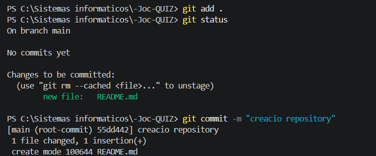
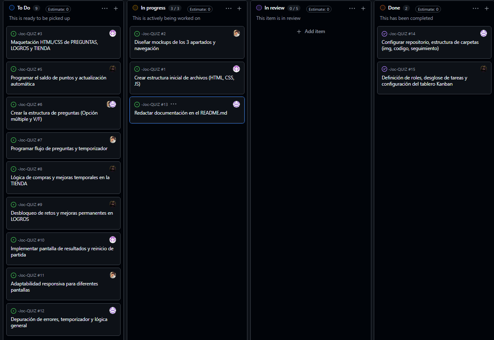
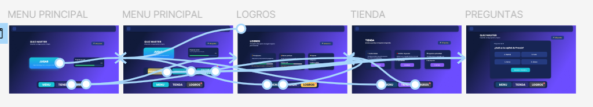
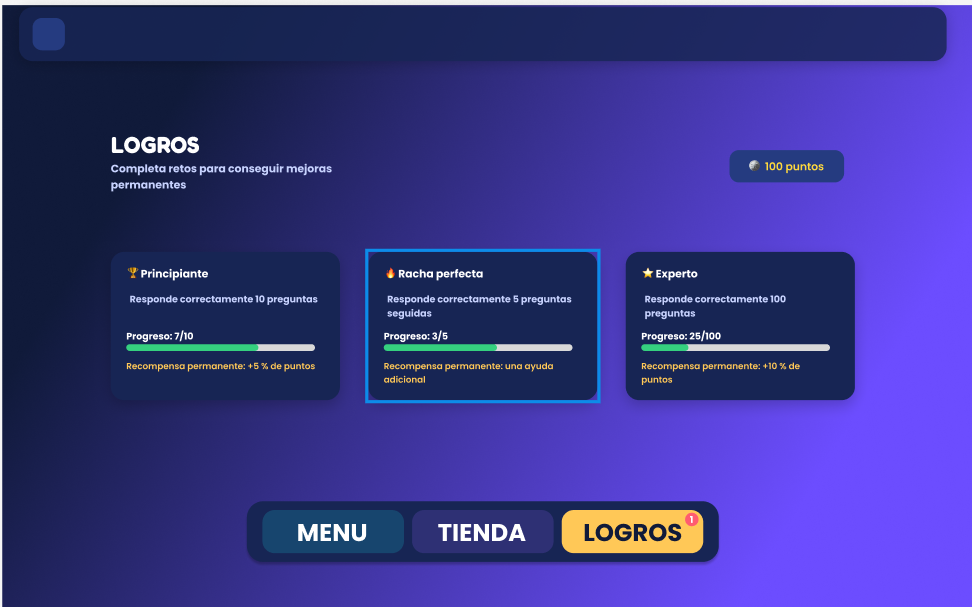
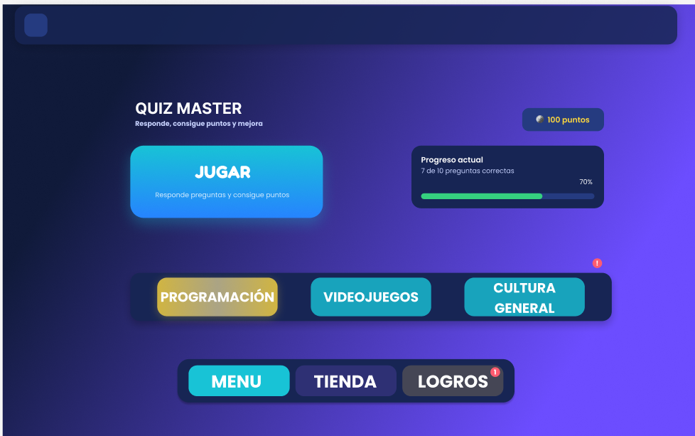
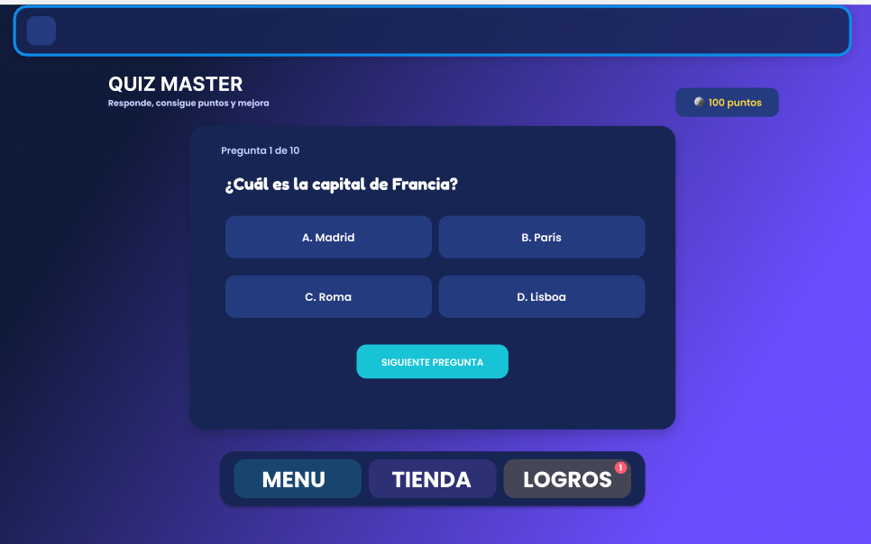
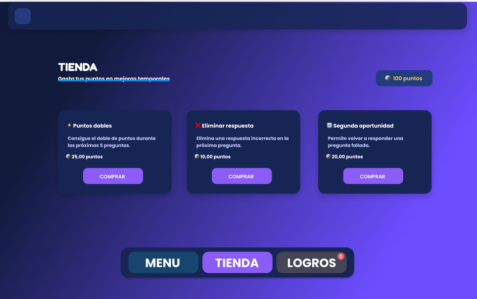

# Primer seguiment 

## Analisis i revision de los requisitos del juego

 
## Organitzacion projecto
### Creaccion del repositorio
Aqui se crea el repositorio i el primer commit 

### Planning de acciones + organitzacion
Se crea un projecto en github 

#### Roles assignados
* Eric: Control de versiones realitzar marges i corregir errores junto con escribir en el seguiment i el README.md 
* Pau: Dissenyador del apartado visual
* Santi: Encargado de assignar tareas
* Moseab: Crear codigo

## Mokup
Imatges del mokup

